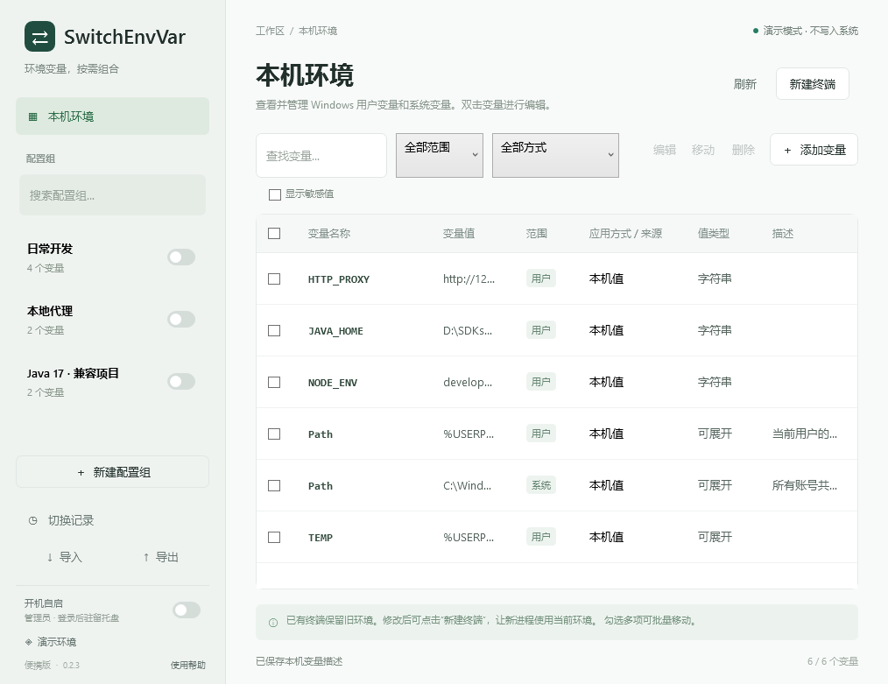

# SwitchEnvVar · Windows 环境变量管理与切换

SwitchEnvVar 是一个使用 C# 和 WPF 编写的 Windows 环境变量管理器。把开发工具链、代理和项目变量分别保存为配置组，需要时可以同时启用多个组。

SwitchEnvVar manages and switches Windows environment variables with composable profiles, a PATH editor, and change previews.



## 功能

- 管理当前账号和系统级变量。支持从本机移入配置组、在组间移动，以及批量移动。
- 同时启用多个配置组。配置重叠时按启用顺序计算，也可手动提高指定组的优先级。
- 逐项编辑 `PATH`，预览修改，查看操作记录，恢复上次状态。
- 给变量添加描述，按描述或配置组来源查找变量。
- 从托盘打开窗口，或再次运行程序唤回已有窗口。可选登录自启。

## 快速体验

从 [GitHub Releases](https://github.com/newwuyu/SwitchEnvVar/releases) 下载便携包。需要 Windows 10 或 11 和 .NET Framework 4.8 或更新版本。解压后，双击「演示模式.cmd」可用模拟变量体验界面。打开 `SwitchEnv.exe` 会请求当前账号的管理员权限。

从 SwitchEnv 升级时，退出旧版，然后覆盖原目录中的程序文件并保留 `data`。新版沿用 `SwitchEnv.exe` 和原有登录任务，可继续使用已有数据和开机自启设置。

登录自启以管理员权限运行。启用前，请把程序放在仅受信任的管理员可修改的目录。设置步骤见[使用说明](使用说明.md)。

## 从源码构建

在 Windows PowerShell 中进入仓库目录，运行以下命令。

```powershell
.\build.ps1
.\build\SwitchEnv.exe --demo
```

产物位于 `build\`。构建使用 Windows 自带的 .NET Framework C# 编译器。使用 `test.ps1` 运行自动测试。详细信息见[开发指南](docs/development.md)和[验证记录](docs/verification.md)。

## 参与开发

欢迎提交问题和改进。反馈问题时请使用演示数据，真实环境变量值可能包含凭据。参阅[贡献指南](CONTRIBUTING.md)和[版本记录](CHANGELOG.md)。

项目采用 [MIT 许可证](LICENSE)。界面的配置组组织方式参考了 [SwitchHosts](https://github.com/oldj/SwitchHosts)。
